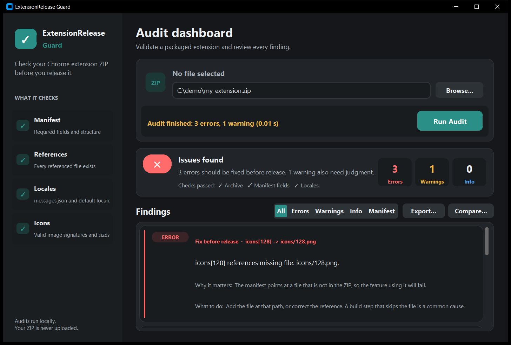

# ExtensionRelease Guard

A Windows desktop tool that inspects a Chrome extension ZIP **locally, before
you publish it**. It reads the archive without extracting or executing anything,
reports problems with remediation guidance, and exports a report.

> **Not a guarantee.** This is a pre-release inspection aid. A clean result means
> only that the checks this tool runs found nothing; it does not prove an
> extension is safe, and it does not guarantee Chrome Web Store compliance or
> approval. It is not affiliated with or endorsed by Google.



## Using it

* **Windows executable:** download `ExtensionReleaseGuard.exe` from the
  [Releases](../../releases) page and run it (no Python needed). Windows
  SmartScreen may warn about an unsigned executable; compare the SHA-256 in the
  release notes with `certutil -hashfile ExtensionReleaseGuard.exe SHA256`.
* **From source** (Python **3.12+**, Windows):

```bash
pip install -e ".[gui]"      # installs customtkinter==5.2.2
python -m extension_guard.gui
```

Choose a ZIP with **Browse** (or drop it on the window) and run the audit.

## Features

* Safe ZIP inspection, manifest, reference, locale and icon checks (below).
* Per-finding guidance, a release-readiness summary and a manifest review.
* Compare two saved JSON reports; HTML/JSON/TXT export; drag-and-drop.

### ZIP inspection

* Enumerate archive entries using :class:`zipfile.ZipFile`.
* Report malformed archives (``zipfile.BadZipFile``) as an error finding.
* Flag **absolute paths** or **path‑traversal** entry names.
* Detect **duplicate entry names**.
* Inspect archive metadata only (nothing is extracted) and flag:
  - **Encrypted** entries, **Unix symbolic-link** entries, and entries whose
    **local-header file name differs from the central directory** (errors).
  - Names that differ **only by letter case** (warning; they collide when
    extracted on Windows).
  - Entries of at least 1 MiB compressed at **100:1 or more** (warning).
* Enforce limits on:
  - Maximum entry count (`MAX_ENTRIES = 1000`).
  - Maximum total uncompressed size (`MAX_UNCOMPRESSED_SIZE = 50 MiB`).
* Return structured results with three categories:
  - ``errors`` – critical problems.
  - ``warnings`` – suspicious or non‑fatal issues.
  - ``info`` – informational notes.

All logic resides in :mod:`extension_guard.zip_inspector`.

An archive that is not a valid ZIP, or that exceeds the entry-count or total-size
limit, stops the audit: no other validator reads its entries. Limitations: sizes
are taken from the archive's declared headers, the local-header comparison is
skipped for over-limit archives, only Unix-style symlinks are detected, and the
data of entries that no validator opens is not CRC-checked.

## Guidance, readiness and manifest review

Every finding carries deterministic, local guidance: what was detected, why it
matters, the file or field involved, what to do, and a level (**Fix before
release**, **Review recommended** or **Informational**, derived from the
severity). Guidance is heuristic advice, never a promise that a fix is safe;
messages the tool does not recognise get no invented advice.

The summary card states a release-readiness result (*Issues found*, *Review
recommended*, *Informational notes only*, *No issues detected*, or *Audit could
not complete*) with a one-line reason, and lists **Checks passed** only when
there is evidence they ran: the archive check always, the downstream checks
(manifest fields, references, locales, icons) only when the pipeline reached
them, the manifest declares something for them to check, and no finding is
unattributed. It never claims the package is secure, certified or approved, and
there is no numeric score. "No issues detected" means only that the checks this
tool runs found nothing.

The **Manifest** tab shows a static review of the root `manifest.json` (read in
memory, at most 1 MiB, never extracted, no extension code is run): name,
version, manifest version, and requested permissions and host access, each
labelled *observation* (a fact about what is requested) or *inconsistency* (a
confirmed defect). The sensitive-permission table is fixed and conservative; an
observation is not a verdict that the permission is unjustified.

## Comparing two reports

**Compare…** (enabled after an audit) loads a saved JSON report and compares it
with the current result: new, fixed and unchanged findings. Findings are matched
on `(severity, rule id, subject)` as a multiset, not on display text, so
rewording a message does not break matching; an unrecognised message gets a
fallback id from its normalised text. Reports are read only (at most 10 MiB);
nothing is written. Malformed JSON, an unsupported schema, or a report whose
summary disagrees with its findings is rejected with a message, not compared.

## Dragging a ZIP onto the window

Drop one `.zip` anywhere on the window to audit it. The file name is shown, paths
with spaces and Unicode work, folders, non-ZIP files and multiple files are
refused with a message, and a drop during a running audit is ignored. It uses the
Windows shell drop (`ctypes`, no dependency). Limits: no highlight while the file
is being dragged (the border flashes once on drop), it does not work if the app
runs elevated and Explorer does not, and **Browse** always works if drop support
is unavailable.

## Exporting a report

After a successful audit, **Export…** in the Findings header saves the result as
**HTML**, **JSON** or **TXT** (UTF-8). Reports contain the ZIP's base file name
only, never its folder. The HTML is a single self-contained page with all
content escaped, no scripts and no external resources. The button stays disabled
until an audit has completed, and after a failed audit.

JSON uses `schema_version: 2`: `file`, `generated_at`, `duration_seconds`,
`result`, `summary`, `readiness`, `manifest_review` and
`findings[{severity, message, id, subject, level, title, why, action}]`. The
change from schema 1 is additive: every schema-1 key is unchanged, so existing
consumers keep working. **Migration:** reports with `schema_version: 1` are still
accepted by Compare; their ids and subjects are derived from the message text,
so they match v2 reports as long as the message wording is the same.

## Requirements

* Python **3.12** or newer, on Windows (the GUI and drag-and-drop are Windows-specific).
* The core audit has no runtime dependencies; the GUI needs `customtkinter==5.2.2`.

## Running the tests

From the project root:

```bash
python -m unittest discover -s tests
```

One real-world test is skipped unless the `REAL_EXTENSION_ZIP` environment variable
points to a local extension ZIP. GUI tests need a desktop session.

## Building the Windows executable

```bash
python -m venv .buildenv
.buildenv\Scripts\python -m pip install -e ".[gui]" pyinstaller
.buildenv\Scripts\python -m PyInstaller --noconfirm --clean --onefile --windowed ^
  --name ExtensionReleaseGuard --collect-data customtkinter --paths src ^
  packaging\launcher.py
```

The executable is written to `dist\ExtensionReleaseGuard.exe`. Build output is
not committed; releases attach it as a separate asset.

## Limitations

* Static inspection only: extension code is never run, so behaviour, remote
  code, privacy practices and store-policy compliance are not assessed.
* Guidance is heuristic advice, not a promise that a fix is safe.
* Drag-and-drop shows no hover highlight and does not work if the app runs
  elevated and Explorer does not. **Browse** always works.
* The executable is unsigned.

## Support

If this tool saves you time, you can [support its development on Ko-fi](https://ko-fi.com/inexperiencedpotato). Donations are optional and do not affect the license.
